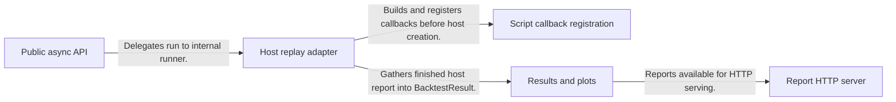
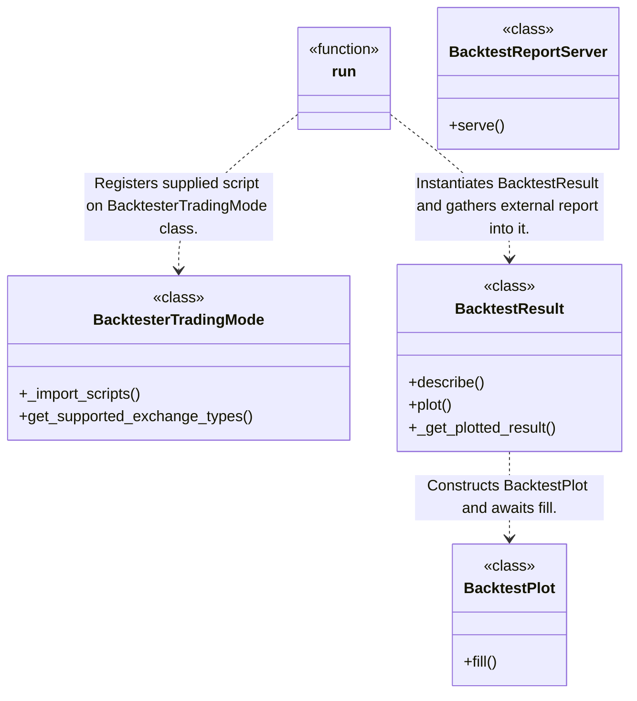
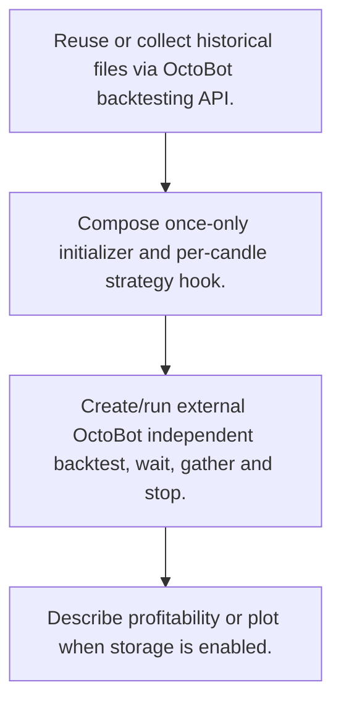
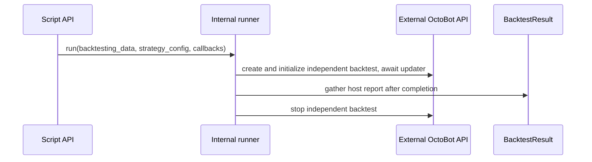

# OctoBot-Script: workflow, design and architecture

Updated: **2026-10-13**
Reviewed Git hash: `3b24149f79abfa1c97b34b2395b41ef04898c480`
Branch: `feature/ayu_develop`
Source diff SHA256: `e3b0c44298fc1c149afbf4c8996fb92427ae41e4649b934ca495991b7852b855`
Scope: **Scripted backtesting facade** / Maintenance: **companion**
Languages: Python, TypeScript

[HTML edition](ayu-develop.html) / [Development](development.md) / [Historical validation](validation.md) / [Full system comparison](../../docs/index.html)

## Purpose and scope

Compose asynchronous candle strategy hooks, obtain historical data through OctoBot APIs and return/plot independent backtesting reports.

## Features and support boundaries

Native = implemented here. Integration = supplied through a named host/API. Limited = material restriction. Not provided = evidenced scope exclusion. Unverified = support/absence not established. Not applicable = outside this artifact type.

| Capability | Status | Implementation and limits | Source |
|---|---|---|---|
| Backtesting | Integration | OctoBot host/backtesting/trading packages provide simulation, market/order/storage behavior. Futures is declared mode compatibility, with execution supplied by host. | [run](../src/octobot_script/internal/runners.py) ([L28](https://github.com/alexcwyu/OctoBot-Script/blob/3b24149f79abfa1c97b34b2395b41ef04898c480/src/octobot_script/internal/runners.py#L28)) / [historical_data](../src/octobot_script/api/data_fetching.py) ([L54](https://github.com/alexcwyu/OctoBot-Script/blob/3b24149f79abfa1c97b34b2395b41ef04898c480/src/octobot_script/api/data_fetching.py#L54)) / [BacktesterTradingMode](../src/octobot_script/internal/backtester_trading_mode.py) ([L23](https://github.com/alexcwyu/OctoBot-Script/blob/3b24149f79abfa1c97b34b2395b41ef04898c480/src/octobot_script/internal/backtester_trading_mode.py#L23)) |
| Live execution | Unverified | Inspected execution API specifically constructs independent historical backtests, not a live/paper session. | [run](../src/octobot_script/internal/runners.py) ([L28](https://github.com/alexcwyu/OctoBot-Script/blob/3b24149f79abfa1c97b34b2395b41ef04898c480/src/octobot_script/internal/runners.py#L28)) |
| Paper trading | Unverified | Inspected execution API specifically constructs independent historical backtests, not a live/paper session. | [run](../src/octobot_script/internal/runners.py) ([L28](https://github.com/alexcwyu/OctoBot-Script/blob/3b24149f79abfa1c97b34b2395b41ef04898c480/src/octobot_script/internal/runners.py#L28)) |
| Event driven | Integration | OctoBot host/backtesting/trading packages provide simulation, market/order/storage behavior. Futures is declared mode compatibility, with execution supplied by host. | [run](../src/octobot_script/internal/runners.py) ([L28](https://github.com/alexcwyu/OctoBot-Script/blob/3b24149f79abfa1c97b34b2395b41ef04898c480/src/octobot_script/internal/runners.py#L28)) / [historical_data](../src/octobot_script/api/data_fetching.py) ([L54](https://github.com/alexcwyu/OctoBot-Script/blob/3b24149f79abfa1c97b34b2395b41ef04898c480/src/octobot_script/api/data_fetching.py#L54)) / [BacktesterTradingMode](../src/octobot_script/internal/backtester_trading_mode.py) ([L23](https://github.com/alexcwyu/OctoBot-Script/blob/3b24149f79abfa1c97b34b2395b41ef04898c480/src/octobot_script/internal/backtester_trading_mode.py#L23)) |
| Vectorized | Unverified | Representative source review did not establish this capability; no claim of absence. | Not applicable to this repository scope. |
| Order management | Integration | OctoBot host/backtesting/trading packages provide simulation, market/order/storage behavior. Futures is declared mode compatibility, with execution supplied by host. | [run](../src/octobot_script/internal/runners.py) ([L28](https://github.com/alexcwyu/OctoBot-Script/blob/3b24149f79abfa1c97b34b2395b41ef04898c480/src/octobot_script/internal/runners.py#L28)) / [historical_data](../src/octobot_script/api/data_fetching.py) ([L54](https://github.com/alexcwyu/OctoBot-Script/blob/3b24149f79abfa1c97b34b2395b41ef04898c480/src/octobot_script/api/data_fetching.py#L54)) / [BacktesterTradingMode](../src/octobot_script/internal/backtester_trading_mode.py) ([L23](https://github.com/alexcwyu/OctoBot-Script/blob/3b24149f79abfa1c97b34b2395b41ef04898c480/src/octobot_script/internal/backtester_trading_mode.py#L23)) |
| Order types | Integration | OctoBot host/backtesting/trading packages provide simulation, market/order/storage behavior. Futures is declared mode compatibility, with execution supplied by host. | [run](../src/octobot_script/internal/runners.py) ([L28](https://github.com/alexcwyu/OctoBot-Script/blob/3b24149f79abfa1c97b34b2395b41ef04898c480/src/octobot_script/internal/runners.py#L28)) / [historical_data](../src/octobot_script/api/data_fetching.py) ([L54](https://github.com/alexcwyu/OctoBot-Script/blob/3b24149f79abfa1c97b34b2395b41ef04898c480/src/octobot_script/api/data_fetching.py#L54)) / [BacktesterTradingMode](../src/octobot_script/internal/backtester_trading_mode.py) ([L23](https://github.com/alexcwyu/OctoBot-Script/blob/3b24149f79abfa1c97b34b2395b41ef04898c480/src/octobot_script/internal/backtester_trading_mode.py#L23)) |
| Multi venue | Unverified | Representative source review did not establish this capability; no claim of absence. | Not applicable to this repository scope. |
| Crypto | Integration | OctoBot host/backtesting/trading packages provide simulation, market/order/storage behavior. Futures is declared mode compatibility, with execution supplied by host. | [run](../src/octobot_script/internal/runners.py) ([L28](https://github.com/alexcwyu/OctoBot-Script/blob/3b24149f79abfa1c97b34b2395b41ef04898c480/src/octobot_script/internal/runners.py#L28)) / [historical_data](../src/octobot_script/api/data_fetching.py) ([L54](https://github.com/alexcwyu/OctoBot-Script/blob/3b24149f79abfa1c97b34b2395b41ef04898c480/src/octobot_script/api/data_fetching.py#L54)) / [BacktesterTradingMode](../src/octobot_script/internal/backtester_trading_mode.py) ([L23](https://github.com/alexcwyu/OctoBot-Script/blob/3b24149f79abfa1c97b34b2395b41ef04898c480/src/octobot_script/internal/backtester_trading_mode.py#L23)) |
| Equities | Unverified | Representative source review did not establish this capability; no claim of absence. | Not applicable to this repository scope. |
| Futures | Integration | OctoBot host/backtesting/trading packages provide simulation, market/order/storage behavior. Futures is declared mode compatibility, with execution supplied by host. | [run](../src/octobot_script/internal/runners.py) ([L28](https://github.com/alexcwyu/OctoBot-Script/blob/3b24149f79abfa1c97b34b2395b41ef04898c480/src/octobot_script/internal/runners.py#L28)) / [historical_data](../src/octobot_script/api/data_fetching.py) ([L54](https://github.com/alexcwyu/OctoBot-Script/blob/3b24149f79abfa1c97b34b2395b41ef04898c480/src/octobot_script/api/data_fetching.py#L54)) / [BacktesterTradingMode](../src/octobot_script/internal/backtester_trading_mode.py) ([L23](https://github.com/alexcwyu/OctoBot-Script/blob/3b24149f79abfa1c97b34b2395b41ef04898c480/src/octobot_script/internal/backtester_trading_mode.py#L23)) |
| Options | Unverified | Trading mode lists OPTION compatibility but inspected facade does not establish option contracts, pricing or order execution. | [BacktesterTradingMode.get_supported_exchange_types](../src/octobot_script/internal/backtester_trading_mode.py) ([L33](https://github.com/alexcwyu/OctoBot-Script/blob/3b24149f79abfa1c97b34b2395b41ef04898c480/src/octobot_script/internal/backtester_trading_mode.py#L33)) |
| Forex | Unverified | Representative source review did not establish this capability; no claim of absence. | Not applicable to this repository scope. |
| Strategy api | Native | Async initializer/strategy callback composition and registration are provided here. | [_build_script](../src/octobot_script/internal/runners.py) ([L91](https://github.com/alexcwyu/OctoBot-Script/blob/3b24149f79abfa1c97b34b2395b41ef04898c480/src/octobot_script/internal/runners.py#L91)) / [_register_script](../src/octobot_script/internal/runners.py) ([L119](https://github.com/alexcwyu/OctoBot-Script/blob/3b24149f79abfa1c97b34b2395b41ef04898c480/src/octobot_script/internal/runners.py#L119)) |
| Optimization | Unverified | Representative source review did not establish this capability; no claim of absence. | Not applicable to this repository scope. |
| Machine learning | Unverified | Representative source review did not establish this capability; no claim of absence. | Not applicable to this repository scope. |
| Reinforcement learning | Unverified | Representative source review did not establish this capability; no claim of absence. | Not applicable to this repository scope. |
| Portfolio | Integration | OctoBot host/backtesting/trading packages provide simulation, market/order/storage behavior. Futures is declared mode compatibility, with execution supplied by host. | [run](../src/octobot_script/internal/runners.py) ([L28](https://github.com/alexcwyu/OctoBot-Script/blob/3b24149f79abfa1c97b34b2395b41ef04898c480/src/octobot_script/internal/runners.py#L28)) / [historical_data](../src/octobot_script/api/data_fetching.py) ([L54](https://github.com/alexcwyu/OctoBot-Script/blob/3b24149f79abfa1c97b34b2395b41ef04898c480/src/octobot_script/api/data_fetching.py#L54)) / [BacktesterTradingMode](../src/octobot_script/internal/backtester_trading_mode.py) ([L23](https://github.com/alexcwyu/OctoBot-Script/blob/3b24149f79abfa1c97b34b2395b41ef04898c480/src/octobot_script/internal/backtester_trading_mode.py#L23)) |
| Risk management | Integration | OctoBot host/backtesting/trading packages provide simulation, market/order/storage behavior. Futures is declared mode compatibility, with execution supplied by host. | [run](../src/octobot_script/internal/runners.py) ([L28](https://github.com/alexcwyu/OctoBot-Script/blob/3b24149f79abfa1c97b34b2395b41ef04898c480/src/octobot_script/internal/runners.py#L28)) / [historical_data](../src/octobot_script/api/data_fetching.py) ([L54](https://github.com/alexcwyu/OctoBot-Script/blob/3b24149f79abfa1c97b34b2395b41ef04898c480/src/octobot_script/api/data_fetching.py#L54)) / [BacktesterTradingMode](../src/octobot_script/internal/backtester_trading_mode.py) ([L23](https://github.com/alexcwyu/OctoBot-Script/blob/3b24149f79abfa1c97b34b2395b41ef04898c480/src/octobot_script/internal/backtester_trading_mode.py#L23)) |
| Performance analytics | Integration | Returns host profitability report; facade formats summaries and storage-backed charts. | [run](../src/octobot_script/internal/runners.py) ([L28](https://github.com/alexcwyu/OctoBot-Script/blob/3b24149f79abfa1c97b34b2395b41ef04898c480/src/octobot_script/internal/runners.py#L28)) / [BacktestResult.describe](../src/octobot_script/model/backtest_result.py) ([L33](https://github.com/alexcwyu/OctoBot-Script/blob/3b24149f79abfa1c97b34b2395b41ef04898c480/src/octobot_script/model/backtest_result.py#L33)) / [BacktestResult.plot](../src/octobot_script/model/backtest_result.py) ([L38](https://github.com/alexcwyu/OctoBot-Script/blob/3b24149f79abfa1c97b34b2395b41ef04898c480/src/octobot_script/model/backtest_result.py#L38)) |
| Historical data | Integration | OctoBot host/backtesting/trading packages provide simulation, market/order/storage behavior. Futures is declared mode compatibility, with execution supplied by host. | [run](../src/octobot_script/internal/runners.py) ([L28](https://github.com/alexcwyu/OctoBot-Script/blob/3b24149f79abfa1c97b34b2395b41ef04898c480/src/octobot_script/internal/runners.py#L28)) / [historical_data](../src/octobot_script/api/data_fetching.py) ([L54](https://github.com/alexcwyu/OctoBot-Script/blob/3b24149f79abfa1c97b34b2395b41ef04898c480/src/octobot_script/api/data_fetching.py#L54)) / [BacktesterTradingMode](../src/octobot_script/internal/backtester_trading_mode.py) ([L23](https://github.com/alexcwyu/OctoBot-Script/blob/3b24149f79abfa1c97b34b2395b41ef04898c480/src/octobot_script/internal/backtester_trading_mode.py#L23)) |
| Streaming data | Unverified | Representative source review did not establish this capability; no claim of absence. | Not applicable to this repository scope. |
| Persistence | Integration | OctoBot host/backtesting/trading packages provide simulation, market/order/storage behavior. Futures is declared mode compatibility, with execution supplied by host. | [run](../src/octobot_script/internal/runners.py) ([L28](https://github.com/alexcwyu/OctoBot-Script/blob/3b24149f79abfa1c97b34b2395b41ef04898c480/src/octobot_script/internal/runners.py#L28)) / [historical_data](../src/octobot_script/api/data_fetching.py) ([L54](https://github.com/alexcwyu/OctoBot-Script/blob/3b24149f79abfa1c97b34b2395b41ef04898c480/src/octobot_script/api/data_fetching.py#L54)) / [BacktesterTradingMode](../src/octobot_script/internal/backtester_trading_mode.py) ([L23](https://github.com/alexcwyu/OctoBot-Script/blob/3b24149f79abfa1c97b34b2395b41ef04898c480/src/octobot_script/internal/backtester_trading_mode.py#L23)) |
| Data pipeline | Integration | OctoBot host/backtesting/trading packages provide simulation, market/order/storage behavior. Futures is declared mode compatibility, with execution supplied by host. | [run](../src/octobot_script/internal/runners.py) ([L28](https://github.com/alexcwyu/OctoBot-Script/blob/3b24149f79abfa1c97b34b2395b41ef04898c480/src/octobot_script/internal/runners.py#L28)) / [historical_data](../src/octobot_script/api/data_fetching.py) ([L54](https://github.com/alexcwyu/OctoBot-Script/blob/3b24149f79abfa1c97b34b2395b41ef04898c480/src/octobot_script/api/data_fetching.py#L54)) / [BacktesterTradingMode](../src/octobot_script/internal/backtester_trading_mode.py) ([L23](https://github.com/alexcwyu/OctoBot-Script/blob/3b24149f79abfa1c97b34b2395b41ef04898c480/src/octobot_script/internal/backtester_trading_mode.py#L23)) |
| Web ui | Limited | Backtest report HTTP server/UI serves analysis reports; this is not a full live trading dashboard. | [BacktestReportServer.serve](../src/octobot_script/model/backtest_report_server.py) ([L263](https://github.com/alexcwyu/OctoBot-Script/blob/3b24149f79abfa1c97b34b2395b41ef04898c480/src/octobot_script/model/backtest_report_server.py#L263)) |
| Cli | Unverified | Representative source review did not establish this capability; no claim of absence. | Not applicable to this repository scope. |
| Monitoring | Unverified | Representative source review did not establish this capability; no claim of absence. | Not applicable to this repository scope. |
| Extension api | Native | Async initializer/strategy callback composition and registration are provided here. | [_build_script](../src/octobot_script/internal/runners.py) ([L91](https://github.com/alexcwyu/OctoBot-Script/blob/3b24149f79abfa1c97b34b2395b41ef04898c480/src/octobot_script/internal/runners.py#L91)) / [_register_script](../src/octobot_script/internal/runners.py) ([L119](https://github.com/alexcwyu/OctoBot-Script/blob/3b24149f79abfa1c97b34b2395b41ef04898c480/src/octobot_script/internal/runners.py#L119)) |
| Native acceleration | Unverified | Representative source review did not establish this capability; no claim of absence. | Not applicable to this repository scope. |
| Distributed execution | Unverified | Representative source review did not establish this capability; no claim of absence. | Not applicable to this repository scope. |

## System components

| Component | Responsibility | Source |
|---|---|---|
| Public async API | Validate user parameters and fetch/reuse historical data. | [run](../src/octobot_script/api/execution.py) ([L21](https://github.com/alexcwyu/OctoBot-Script/blob/3b24149f79abfa1c97b34b2395b41ef04898c480/src/octobot_script/api/execution.py#L21)) / [historical_data](../src/octobot_script/api/data_fetching.py) ([L54](https://github.com/alexcwyu/OctoBot-Script/blob/3b24149f79abfa1c97b34b2395b41ef04898c480/src/octobot_script/api/data_fetching.py#L54)) |
| Host replay adapter | Create external OctoBot backtest and manage session/results. | [run](../src/octobot_script/internal/runners.py) ([L28](https://github.com/alexcwyu/OctoBot-Script/blob/3b24149f79abfa1c97b34b2395b41ef04898c480/src/octobot_script/internal/runners.py#L28)) |
| Script callback registration | Compose and inject per-candle initialization/strategy hooks. | [_build_script](../src/octobot_script/internal/runners.py) ([L91](https://github.com/alexcwyu/OctoBot-Script/blob/3b24149f79abfa1c97b34b2395b41ef04898c480/src/octobot_script/internal/runners.py#L91)) / [_register_script](../src/octobot_script/internal/runners.py) ([L119](https://github.com/alexcwyu/OctoBot-Script/blob/3b24149f79abfa1c97b34b2395b41ef04898c480/src/octobot_script/internal/runners.py#L119)) |
| Results and plots | Summarize reports and load storage-backed plots. | [BacktestResult.plot](../src/octobot_script/model/backtest_result.py) ([L38](https://github.com/alexcwyu/OctoBot-Script/blob/3b24149f79abfa1c97b34b2395b41ef04898c480/src/octobot_script/model/backtest_result.py#L38)) / [BacktestResult.describe](../src/octobot_script/model/backtest_result.py) ([L33](https://github.com/alexcwyu/OctoBot-Script/blob/3b24149f79abfa1c97b34b2395b41ef04898c480/src/octobot_script/model/backtest_result.py#L33)) |
| Report HTTP server | Serve report UI/history. | [BacktestReportServer.serve](../src/octobot_script/model/backtest_report_server.py) ([L263](https://github.com/alexcwyu/OctoBot-Script/blob/3b24149f79abfa1c97b34b2395b41ef04898c480/src/octobot_script/model/backtest_report_server.py#L263)) |

## Architecture and component boundaries

The component view summarizes inspected responsibility boundaries. Arrows identify the documented API/data dependencies; this is not a deployment-readiness claim.

- Delegates run to internal runner.: [run](../src/octobot_script/api/execution.py) ([L21](https://github.com/alexcwyu/OctoBot-Script/blob/3b24149f79abfa1c97b34b2395b41ef04898c480/src/octobot_script/api/execution.py#L21))
- Builds and registers callbacks before host creation.: [run](../src/octobot_script/internal/runners.py) ([L28](https://github.com/alexcwyu/OctoBot-Script/blob/3b24149f79abfa1c97b34b2395b41ef04898c480/src/octobot_script/internal/runners.py#L28))
- Gathers finished host report into BacktestResult.: [run](../src/octobot_script/internal/runners.py) ([L28](https://github.com/alexcwyu/OctoBot-Script/blob/3b24149f79abfa1c97b34b2395b41ef04898c480/src/octobot_script/internal/runners.py#L28))
- Reports available for HTTP serving.: [BacktestReportServer.serve](../src/octobot_script/model/backtest_report_server.py) ([L263](https://github.com/alexcwyu/OctoBot-Script/blob/3b24149f79abfa1c97b34b2395b41ef04898c480/src/octobot_script/model/backtest_report_server.py#L263))

## Design decisions

| Decision | Rationale | Tradeoff | Evidence |
|---|---|---|---|
| Inject script callback into host trading mode. | Reuse existing OctoBot execution/context and historical replay machinery. | Class-level _import_scripts replacement shares mutable registration across same-process runs. | [_register_script](../src/octobot_script/internal/runners.py) ([L119](https://github.com/alexcwyu/OctoBot-Script/blob/3b24149f79abfa1c97b34b2395b41ef04898c480/src/octobot_script/internal/runners.py#L119)) |
| Require run storage for plots. | Reports load historical/chart data through run database identifiers. | Storage-disabled backtests cannot plot through this API. | [BacktestResult.plot](../src/octobot_script/model/backtest_result.py) ([L38](https://github.com/alexcwyu/OctoBot-Script/blob/3b24149f79abfa1c97b34b2395b41ef04898c480/src/octobot_script/model/backtest_result.py#L38)) |

## Class and interface relationships

Each node is a reviewed source symbol. Function/module nodes are explicitly labeled; they do not imply Python classes. Only reviewed relationships are drawn.

- **run** (function): [run](../src/octobot_script/internal/runners.py) ([L28](https://github.com/alexcwyu/OctoBot-Script/blob/3b24149f79abfa1c97b34b2395b41ef04898c480/src/octobot_script/internal/runners.py#L28))
- **BacktesterTradingMode** (class): [BacktesterTradingMode](../src/octobot_script/internal/backtester_trading_mode.py) ([L23](https://github.com/alexcwyu/OctoBot-Script/blob/3b24149f79abfa1c97b34b2395b41ef04898c480/src/octobot_script/internal/backtester_trading_mode.py#L23))
- **BacktestResult** (class): [BacktestResult.plot](../src/octobot_script/model/backtest_result.py) ([L38](https://github.com/alexcwyu/OctoBot-Script/blob/3b24149f79abfa1c97b34b2395b41ef04898c480/src/octobot_script/model/backtest_result.py#L38))
- **BacktestPlot** (class): [BacktestPlot.fill](../src/octobot_script/model/backtest_plot.py) ([L56](https://github.com/alexcwyu/OctoBot-Script/blob/3b24149f79abfa1c97b34b2395b41ef04898c480/src/octobot_script/model/backtest_plot.py#L56))
- **BacktestReportServer** (class): [BacktestReportServer.serve](../src/octobot_script/model/backtest_report_server.py) ([L263](https://github.com/alexcwyu/OctoBot-Script/blob/3b24149f79abfa1c97b34b2395b41ef04898c480/src/octobot_script/model/backtest_report_server.py#L263))

## Workflow

### Script historical run

Runtime simulation, exchange execution and strategy context semantics are supplied by OctoBot/Trading/Tentacles hosts.

1. Reuse or collect historical files via OctoBot backtesting API.. [historical_data](../src/octobot_script/api/data_fetching.py) ([L54](https://github.com/alexcwyu/OctoBot-Script/blob/3b24149f79abfa1c97b34b2395b41ef04898c480/src/octobot_script/api/data_fetching.py#L54))
2. Compose once-only initializer and per-candle strategy hook.. [_build_script](../src/octobot_script/internal/runners.py) ([L91](https://github.com/alexcwyu/OctoBot-Script/blob/3b24149f79abfa1c97b34b2395b41ef04898c480/src/octobot_script/internal/runners.py#L91)) / [_register_script](../src/octobot_script/internal/runners.py) ([L119](https://github.com/alexcwyu/OctoBot-Script/blob/3b24149f79abfa1c97b34b2395b41ef04898c480/src/octobot_script/internal/runners.py#L119))
3. Create/run external OctoBot independent backtest, wait, gather and stop.. [run](../src/octobot_script/internal/runners.py) ([L28](https://github.com/alexcwyu/OctoBot-Script/blob/3b24149f79abfa1c97b34b2395b41ef04898c480/src/octobot_script/internal/runners.py#L28))
4. Describe profitability or plot when storage is enabled.. [BacktestResult.describe](../src/octobot_script/model/backtest_result.py) ([L33](https://github.com/alexcwyu/OctoBot-Script/blob/3b24149f79abfa1c97b34b2395b41ef04898c480/src/octobot_script/model/backtest_result.py#L33)) / [BacktestResult.plot](../src/octobot_script/model/backtest_result.py) ([L38](https://github.com/alexcwyu/OctoBot-Script/blob/3b24149f79abfa1c97b34b2395b41ef04898c480/src/octobot_script/model/backtest_result.py#L38))

## Sequence

Independent replay facade

Host participant and runtime candle callbacks are external/injected; sequence shows inspected orchestration.

- run(backtesting_data, strategy_config, callbacks): [run](../src/octobot_script/api/execution.py) ([L21](https://github.com/alexcwyu/OctoBot-Script/blob/3b24149f79abfa1c97b34b2395b41ef04898c480/src/octobot_script/api/execution.py#L21))
- create and initialize independent backtest; await updater: [run](../src/octobot_script/internal/runners.py) ([L28](https://github.com/alexcwyu/OctoBot-Script/blob/3b24149f79abfa1c97b34b2395b41ef04898c480/src/octobot_script/internal/runners.py#L28))
- gather host report after completion: [run](../src/octobot_script/internal/runners.py) ([L28](https://github.com/alexcwyu/OctoBot-Script/blob/3b24149f79abfa1c97b34b2395b41ef04898c480/src/octobot_script/internal/runners.py#L28))
- stop independent backtest: [run](../src/octobot_script/internal/runners.py) ([L28](https://github.com/alexcwyu/OctoBot-Script/blob/3b24149f79abfa1c97b34b2395b41ef04898c480/src/octobot_script/internal/runners.py#L28))

## Strengths and limits

### Strengths

- Historical file matching avoids collecting the same available range again. [historical_data](../src/octobot_script/api/data_fetching.py) ([L54](https://github.com/alexcwyu/OctoBot-Script/blob/3b24149f79abfa1c97b34b2395b41ef04898c480/src/octobot_script/api/data_fetching.py#L54))

### Limitations

- Callback exceptions are logged and swallowed by combined callback; callers should inspect logs and report rather than assume every candle succeeded. [_build_script](../src/octobot_script/internal/runners.py) ([L91](https://github.com/alexcwyu/OctoBot-Script/blob/3b24149f79abfa1c97b34b2395b41ef04898c480/src/octobot_script/internal/runners.py#L91))

## Validation scope

The linked validation and command records preserve actual historical runs and user-authorized exclusions. This source/document review does not rerun application tests, establish live trading readiness or rank benchmark performance. Current data, credential and runtime prerequisites remain material.

[Repository validation](validation.md) / [Executed checks](maintenance/index.md)

## Source map

| Reviewed symbol/path | Inspected responsibility | Actual file SHA256 |
|---|---|---|
| [run](../src/octobot_script/api/execution.py) ([L21](https://github.com/alexcwyu/OctoBot-Script/blob/3b24149f79abfa1c97b34b2395b41ef04898c480/src/octobot_script/api/execution.py#L21)) | Validates mutually exclusive tentacles_config/profile_id, configures logging, delegates to internal runner. | `273eb65df70739d688bf3ccc0a67508c1dce3ad8563732bece0e89f72d0882fe` |
| [run](../src/octobot_script/internal/runners.py) ([L28](https://github.com/alexcwyu/OctoBot-Script/blob/3b24149f79abfa1c97b34b2395b41ef04898c480/src/octobot_script/internal/runners.py#L28)) | Creates BacktestResult, registers script, constructs external independent backtesting, awaits completion, gathers result and stops session. | `4f74867b8f0a6078bdf08b879b5e1839d291317c4427811894e79e5655822f87` |
| [_build_script](../src/octobot_script/internal/runners.py) ([L91](https://github.com/alexcwyu/OctoBot-Script/blob/3b24149f79abfa1c97b34b2395b41ef04898c480/src/octobot_script/internal/runners.py#L91)) | Composes initialization callback once before per-candle strategy callback; logs callback exceptions. | `4f74867b8f0a6078bdf08b879b5e1839d291317c4427811894e79e5655822f87` |
| [_register_script](../src/octobot_script/internal/runners.py) ([L119](https://github.com/alexcwyu/OctoBot-Script/blob/3b24149f79abfa1c97b34b2395b41ef04898c480/src/octobot_script/internal/runners.py#L119)) | Replaces BacktesterTradingMode._import_scripts and wraps reload_config to activate FULL_CANDLES and strategy config. | `4f74867b8f0a6078bdf08b879b5e1839d291317c4427811894e79e5655822f87` |
| [historical_data](../src/octobot_script/api/data_fetching.py) ([L54](https://github.com/alexcwyu/OctoBot-Script/blob/3b24149f79abfa1c97b34b2395b41ef04898c480/src/octobot_script/api/data_fetching.py#L54)) | Normalizes timestamps; reuses matching historical file or constructs/runs external exchange collector. | `fe2eba88527cf592f142836a27eb6ed008259ae462dacd550cc2f80e350bb4f7` |
| [BacktesterTradingMode](../src/octobot_script/internal/backtester_trading_mode.py) ([L23](https://github.com/alexcwyu/OctoBot-Script/blob/3b24149f79abfa1c97b34b2395b41ef04898c480/src/octobot_script/internal/backtester_trading_mode.py#L23)) | Subclasses external AbstractScriptedTradingMode and calls _import_scripts on construction. | `5897902667a923badb1b36933a99ed5fcdbcc52cc5c9612b299f021692a4e266` |
| [BacktesterTradingMode.get_supported_exchange_types](../src/octobot_script/internal/backtester_trading_mode.py) ([L33](https://github.com/alexcwyu/OctoBot-Script/blob/3b24149f79abfa1c97b34b2395b41ef04898c480/src/octobot_script/internal/backtester_trading_mode.py#L33)) | Declares spot/future/margin/option compatibility only; declaration is not verified option execution support. | `5897902667a923badb1b36933a99ed5fcdbcc52cc5c9612b299f021692a4e266` |
| [BacktestResult.plot](../src/octobot_script/model/backtest_result.py) ([L38](https://github.com/alexcwyu/OctoBot-Script/blob/3b24149f79abfa1c97b34b2395b41ef04898c480/src/octobot_script/model/backtest_result.py#L38)) | Requires enabled run storage, constructs BacktestPlot, fills it and optionally shows. | `2792808d294e53773d41d86fa82f2b553ca8b9db747c47c719e9701ee3ea1a7d` |
| [BacktestResult.describe](../src/octobot_script/model/backtest_result.py) ([L33](https://github.com/alexcwyu/OctoBot-Script/blob/3b24149f79abfa1c97b34b2395b41ef04898c480/src/octobot_script/model/backtest_result.py#L33)) | Formats duration/candle count, bot and market average profitability and strategy configuration. | `2792808d294e53773d41d86fa82f2b553ca8b9db747c47c719e9701ee3ea1a7d` |
| [BacktestPlot.fill](../src/octobot_script/model/backtest_plot.py) ([L56](https://github.com/alexcwyu/OctoBot-Script/blob/3b24149f79abfa1c97b34b2395b41ef04898c480/src/octobot_script/model/backtest_plot.py#L56)) | Loads backtesting storage/chart data to construct plotted report. | `29fd5a8f06869961feaefde808d8dabd8bfe4f3936039b1cab49171410991594` |
| [BacktestReportServer.serve](../src/octobot_script/model/backtest_report_server.py) ([L263](https://github.com/alexcwyu/OctoBot-Script/blob/3b24149f79abfa1c97b34b2395b41ef04898c480/src/octobot_script/model/backtest_report_server.py#L263)) | Serves packaged/local backtesting report via HTTP server. | `b88165af39a5af37707603fb1fd31be12a91ad8d96dd120fbbdf3350d39c85fd` |

## Documentation provenance

Review date: 2026-10-13. Full committed source HEAD: `3b24149f79abfa1c97b34b2395b41ef04898c480`. Template version: 2. 7 source files were independently hashed for this guide.

[Evidence catalog](../../docs/systems-2026-10-13/catalog.json) / [Standard template](../../docs/guidelines/APP_TEMPLATE.md)

- Read-only source audit of inventory HEAD 3b24149f79abfa1c97b34b2395b41ef04898c480; no runtime execution, credential check or live-production assertion. Existing validation records remain separate historical evidence.
- Inspected implementation/configuration coverage: src/octobot_script/api/execution.py, src/octobot_script/internal/runners.py, src/octobot_script/api/data_fetching.py, src/octobot_script/internal/backtester_trading_mode.py, src/octobot_script/model/backtest_result.py, src/octobot_script/model/backtest_plot.py, src/octobot_script/model/backtest_report_server.py
- Source symbols and call chains are representative coverage, not exhaustive connector, strategy or product certification. Integration statuses identify dependencies that supply the runtime behavior.
