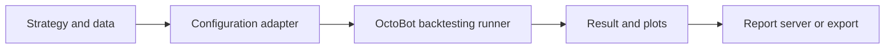
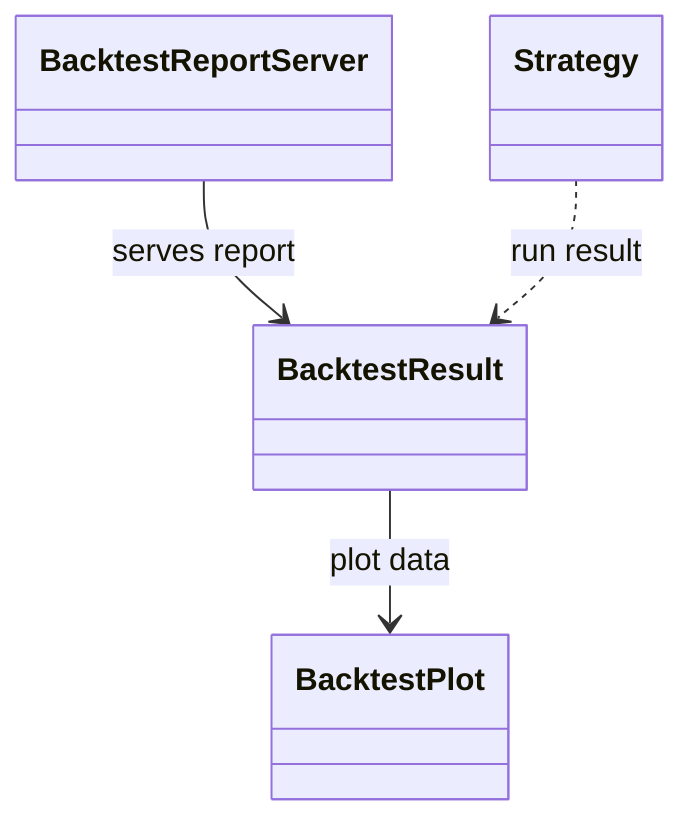
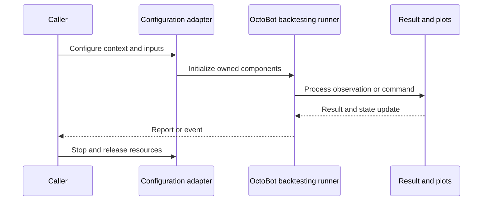
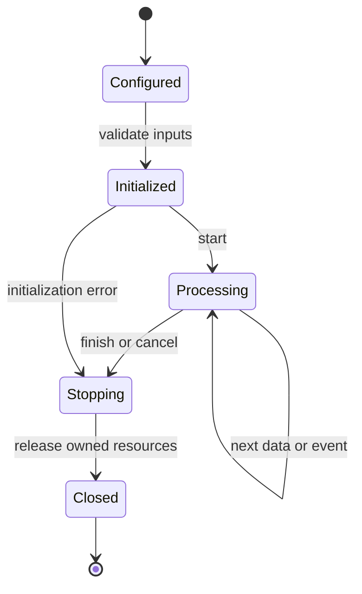
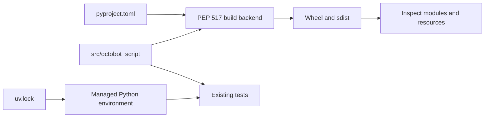
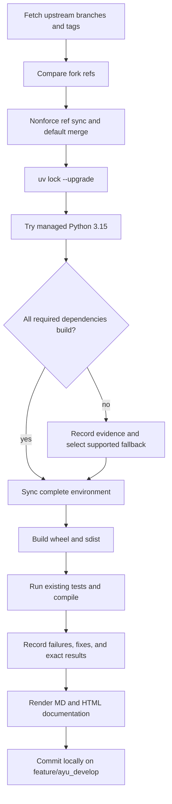

# OctoBot-Script: architecture and development

Script offers a Python strategy/backtest API on top of OctoBot, together with historical-data fetching, plots, result objects, and a bundled React report UI.

## Components and boundaries

Public api modules call internal runners and adapt OctoBot configuration/trading modes. Strategy describes user callbacks and configuration. BacktestResult aggregates execution results; BacktestPlot holds data for visualization; BacktestReportServer serves the embedded report. A module-local tentacles import directory isolates installed plugin data; an explicit USE_CUSTOM_TENTACLES option delegates plugin provisioning to the caller.

The following class view names implementation classes. Cross-package types are supplied by the host ecosystem; arrows describe inheritance or usage, not copied ownership.

## Runtime workflow

Fetch or select historical data, construct strategy callbacks/configuration, initialize a backtesting runner and tentacles activation, execute the independent backtest, gather reports/plots, and optionally serve or export the report UI. The JavaScript build writes the bundled page into the Python package resource tree before wheel construction.

This sequence is an architectural view of responsibility and resource ownership. Individual plugin, connector, and strategy implementations can add asynchronous events and error branches. The lifecycle below is a conceptual operating workflow, rather than a claim that every component has one shared state enum.

## Features and extension points

Async backtest execution; user strategy callbacks; historical data download APIs; plotting helpers; report server and result models; social-service configuration; self-contained report assets.

Extend the owning component behind its existing public interface. Keep metadata and configuration alongside plugin/strategy resources. Exchange-specific behavior belongs in an adapter; strategy decisions belong in the strategy/evaluator layer; persistence schema and migrations belong with the storage implementation. Review the source map below before changing a boundary, and exercise the existing tests associated with that boundary.

## Packaging and dependency design

Python sources and embedded resources move together into src. The legacy setup.py hooks are removed in favor of one PEP 621/Hatch build; npm ci and npm run build are explicit preparation steps, and plugin installation is explicit. The source dependency now targets the merged OctoBot monorepo; older profile/Tentacles Manager assumptions need validation against its newer API.

The lock records exact package versions, hashes, platform markers, and local source mappings. Path sources deliberately bind related repositories in this workspace; clone sibling repositories at the documented names before synchronization. Published packaging metadata describes public dependencies, while uv source settings select this development workspace. Resolve dependency changes with uv lock --upgrade and retain the generated lock, then verify the same locked environment.

## Maintenance workflow

All upstream branches and tags are fetched. Fork updates use nonforce pushes; a divergent branch is merged without erasing fork history. The default branch is merged into feature/ayu_develop with package/resource conflicts reconciled in their installed locations. Build and test evidence is recorded before a local maintenance commit. Feature branch publication is a separate root-level action.

No existing test assertions are removed and no new test cases are introduced in this maintenance pass. Corrected fixtures preserve coverage while making paths, corruption inputs, and resource cleanup compatible with the selected interpreter. A failed test or unsupported dependency is reported explicitly in [validation](validation.md); package build success does not imply strategy correctness, profitability, or successful live connectivity.

## Source map

| Source | Responsibility and location |
| --- | --- |
| [execution.py](../src/octobot_script/api/execution.py) | src/octobot_script/api/execution.py |
| [data_fetching.py](../src/octobot_script/api/data_fetching.py) | src/octobot_script/api/data_fetching.py |
| [ploting.py](../src/octobot_script/api/ploting.py) | src/octobot_script/api/ploting.py |
| [runners.py](../src/octobot_script/internal/runners.py) | src/octobot_script/internal/runners.py |
| [octobot_mocks.py](../src/octobot_script/internal/octobot_mocks.py) | src/octobot_script/internal/octobot_mocks.py |
| [backtester_trading_mode.py](../src/octobot_script/internal/backtester_trading_mode.py) | src/octobot_script/internal/backtester_trading_mode.py |
| [strategy.py](../src/octobot_script/model/strategy.py) | src/octobot_script/model/strategy.py |
| [backtest_result.py](../src/octobot_script/model/backtest_result.py) | src/octobot_script/model/backtest_result.py |
| [backtest_plot.py](../src/octobot_script/model/backtest_plot.py) | src/octobot_script/model/backtest_plot.py |
| [backtest_report_server.py](../src/octobot_script/model/backtest_report_server.py) | src/octobot_script/model/backtest_report_server.py |
| [pyproject.toml](../pyproject.toml) | pyproject.toml |
| [uv.lock](../uv.lock) | uv.lock |
| [README.md](../README.md) | README.md |

## Further reading

Use [development.md](development.md) for reproducible commands and [validation.md](validation.md) for exact interpreter, dependency, build, test, and blocker evidence. The equivalent [HTML architecture document](ayu-develop.html) supports browsing and rendered diagrams.
